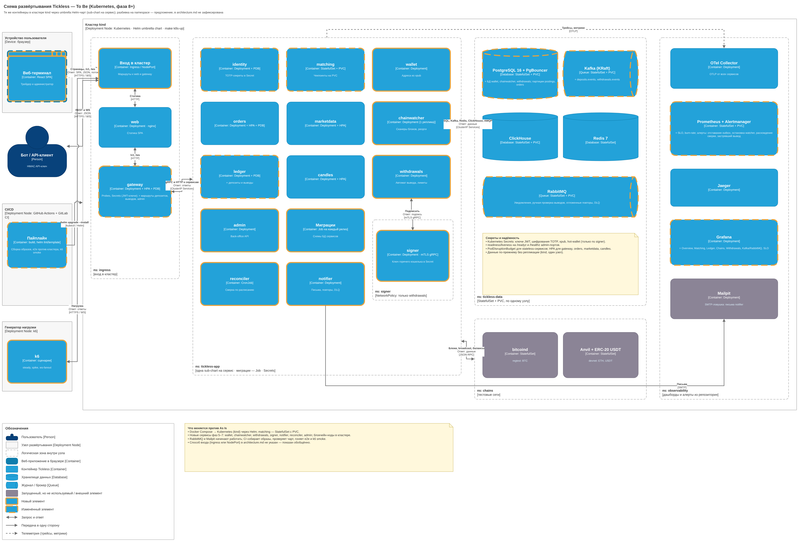
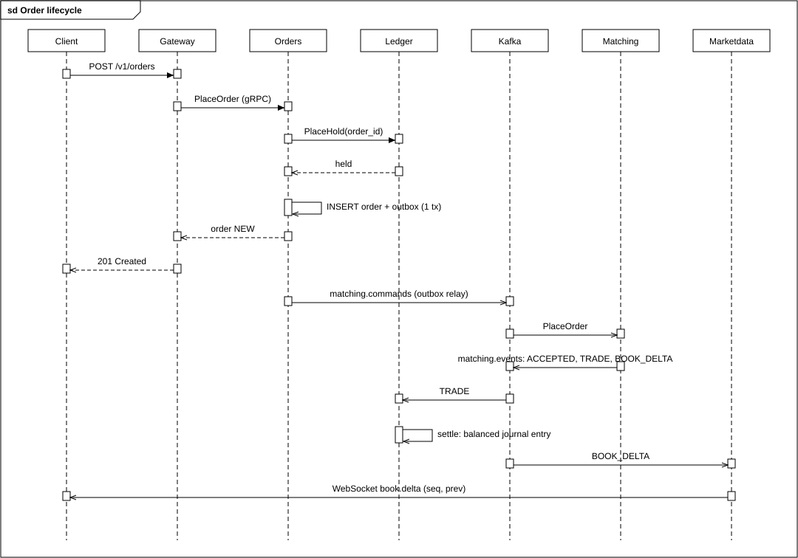

<div align="center">

# Tickless

Self-hostable спот-биржа криптовалют на Go. Только regtest и локальные девнеты, никаких mainnet.

**[SPEC.md](SPEC.md)** · **[PROGRESS.md](PROGRESS.md)** · [Быстрый старт](#быстрый-старт) · [Возможности](#возможности) · [Архитектура](#архитектура) · [Тесты](#тестирование) · [ADR](#архитектурные-решения)

<br />


</div>

---

## Статус

**Фаза 5 из 11.** Регистрация, вход, API-ключи с HMAC-подписью, ордера REST и WebSocket, сверка в двойной записи (ledger), рыночные данные и свечи, веб-терминал на widget-сетке и **депозиты**: BTC на regtest, ETH и тестовый ERC-20 USDT на Anvil, с подтверждениями и обработкой реорганизаций. Дальше фаза 6 (выводы и уведомления), план в [PROGRESS.md](PROGRESS.md).

Что проверено, что нет, подробно в [PROGRESS.md](PROGRESS.md) с командами и выводами. Здесь только то, что уже есть доказательство.

---

## Возможности

| | |
|---|---|
| **Аккаунты** | регистрация, вход, JWT, API-ключи с HMAC-подписью, подтверждение почты (для локальной сборки отключено до фазы 6) |
| **Ордера** | лимитные и рыночные, GTC / IOC / FOK, post-only, отмена, отмена всех по рынку, `client_order_id` для идемпотентности |
| **Депозиты** | свой адрес на каждую цепь (выведен из xpub, без приватных ключей), ожидающие депозиты с числом подтверждений, зачисление после порога (BTC 2, ETH 12), реорг до порога никогда не зачисляет |
| **Баланс** | доступный и заблокированный остаток по активам, полная история проводок |
| **Рыночные данные** | REST и публичный WebSocket: стакан (snapshot + delta с `seq` и `prev`), сделки, тикер, свечи 1m–1d |
| **Приватный WebSocket** | собственные ордера, исполнения и балансы, фильтр по пользователю |
| **Терминал** | React + TypeScript + Vite, панели-виджеты, каждая панель один файл |
| **Наблюдаемость** | OpenTelemetry, Jaeger, Prometheus, Grafana, трассы через Kafka и outbox |

---

## Быстрый старт

Нужны Docker Desktop и Go 1.27. Для `make test` без gcc используется контейнер `golang:1.27`.

```bash
make up          # стек: Postgres+pgbouncer, Redis, Kafka (KRaft), RabbitMQ, ClickHouse, OTel, Jaeger, Prometheus, Grafana, Mailpit
make test        # юнит-тесты с -race по всем модулям
make lint        # golangci-lint + buf lint
make fuzz        # fuzz: pkg/money, движок матчинга
make bench       # движок против целей SPEC §5 (PASS/FAIL) и pprof
make e2e         # сквозной набор против запущенного make up
make down
```

| Интерфейс | Адрес |
|---|---|
| Веб-терминал | http://localhost:8088 |
| Grafana | http://localhost:13000 (admin / admin) |
| Jaeger | http://localhost:16686 |
| Prometheus | http://localhost:9090 |
| Mailpit | http://localhost:18025 |
| RabbitMQ | http://localhost:15672 (tickless / tickless) |

Все учётные данные здесь заглушки для локальной разработки. Хостовые порты сдвинуты, чтобы не конфликтовать с локальными установками и другими стеками: gateway `18080`, Postgres `15433`, Kafka `19092`, Grafana `13000`, Mailpit `18025`, OTel `14317`/`14318`. Внутри контейнеров всё по стандартным портам.

### Пример через curl

```bash
curl -s localhost:8080/v1/markets | jq
curl -s -XPOST localhost:8080/v1/auth/signup -d '{"email":"me@example.com","password":"correct horse battery"}'
TOKEN=$(curl -s -XPOST localhost:8080/v1/auth/login -d '{"email":"me@example.com","password":"correct horse battery"}' | jq -r .access_token)
curl -s -XPOST localhost:8080/v1/orders -H "Authorization: Bearer $TOKEN" \
  -d '{"market":"BTC-USDT","side":"buy","type":"limit","price":"50000.00","quantity":"0.1"}'
```

Без средств заказ вернёт 422. Баланс для разработки выдаётся через `make seed EMAIL=... ASSET=USDT AMOUNT=100000` (RPC `AdminCredit`, включается `LEDGER_ALLOW_SEED=true`). Все dev-переключатели помечены `DEV ONLY` в [deploy/compose/docker-compose.yml](deploy/compose/docker-compose.yml).

---

## Архитектура

Система состоит из сервисов на Go. Каждый сервис владеет своей базой PostgreSQL, сервисы не читают чужие таблицы. Межсервисные команды идут по gRPC, события по Kafka через transactional outbox.

| Сервис | Ответственность |
|---|---|
| `gateway` | публичный REST и WebSocket, JWT и HMAC, rate limit в Redis, idempotency |
| `identity` | пользователи, пароли (argon2id), API-ключи, роли |
| `orders` | проверка ордеров по правилам рынка, hold через ledger, запись команд в outbox |
| `matching` | один детерминированный движок на рынок, вход `matching.commands`, выход `matching.events`, снапшоты |
| `ledger` | двойная запись, холды, расчёт сделок и комиссий, балансы никогда не уходят в минус |
| `marketdata` | стакан, тикер, сделки, снапшоты в Redis, публичный WebSocket |
| `candles` | Kafka → ClickHouse, материализованные представления OHLCV |
| `wallet` | адреса депозита из xpub (BIP84 для BTC, BIP44 для ETH), без приватных ключей; адрес выдаётся только после регистрации в chainwatcher |
| `chainwatcher` | сканеры bitcoind и Anvil, подтверждения, откат к общему предку при реорге, события `deposits.events` через outbox |

### Диаграммы

**C4 — архитектура Tickless.** Исходники `.drawio` лежат в [docs/c4/](docs/c4/).

<a href="docs/c4/01_deployment.png"></a>

Нажмите на картинку, чтобы открыть её в полном размере.

### Жизненный цикл ордера

Диаграмма в стиле StarUML (sequence diagram), сгенерирована из кода, а не нарисована вручную: [docs/diagrams/order-sequence.svg](docs/diagrams/order-sequence.svg).



Порядок событий: `ACCEPTED`, затем `TRADE` и `BOOK_DELTA` по уровням, затем терминальный `CANCELLED` или итоговая `BOOK_DELTA`. Повторный запуск команд даёт идентичные события (ADR 0003).

### Стек

**Бэкенд:** Go 1.27, go.work, pgx v5, sqlc, goose, go-redis v9, franz-go, clickhouse-go v2, gRPC + Protobuf (buf), chi, coder/websocket

**Инфраструктура:** PostgreSQL 16 + pgbouncer, Redis 7, Kafka (KRaft), RabbitMQ 4, ClickHouse 24.8, OpenTelemetry Collector, Jaeger, Prometheus, Grafana, Alertmanager

**Фронтенд:** React 19, TypeScript, Vite, lightweight-charts, react-grid-layout

---

## Тестирование

| Команда | Что проверяет |
|---|---|
| `make test` | юнит-тесты всех модулей с `-race`, покрытие |
| `make test-integration` | testcontainers: PostgreSQL, Kafka, ClickHouse |
| `make lint` | golangci-lint, buf lint, promtool для правил алертов |
| `make bench` | движок против целей SPEC §5 |
| `make e2e` | сквозной сценарий против `make up` |
| `make chaos-dup` | каждое сообщение Kafka публикуется дважды; итоги должны совпасть |

Последний прогон `make test` (контейнер `golang:1.27`, `-race`): все 9 модулей, 14 пакетов с `ok`, падений нет. Вывод сохранён в scratchpad сессии, в репозиторий не коммитится.

Что **не** подтверждено в этом README: `make lint`, `make up`, `make e2e` на текущем коммите в этом прогоне не запускались. Их результаты будут в [PROGRESS.md](PROGRESS.md), когда пройдут.

---

## Результаты движка (`make bench`, Linux)

| Цель SPEC §5 | Результат |
|---|---|
| ≥ 1 млн команд/с, один рынок | ~6.5 млн команд/с (смесь add/cancel/match) |
| p99 < 20 мкс | ~0.5 мкс |
| 0 аллокаций после прогрева | 0 mallocs на 5 000 000 команд |

Подробности, профили и худший случай (100k уровней, ~30 мкс): [docs/perf/engine](docs/perf/engine/README.md).

## Рыночные данные (локальный стек)

| Цель | Результат |
|---|---|
| Клиент WebSocket восстанавливает стакан точно | проверено против движка после каждой команды и по настоящему сокету |
| Свечи всех интервалов равны сделкам | проверено независимой агрегацией, в т.ч. при дублях Kafka |
| Задержка доставки дельты стакана p99 < 100 мс | **9.3 мс** (метка времени Kafka → запись в сокет) |

---

## Депозиты (локальный стек)

| Цель | Результат |
|---|---|
| Зачисление ≤ 10 с после порога подтверждений (SPEC §5) | **~0,5 с** для BTC и ETH (e2e меряет от блока, давшего порог, до баланса в API) |
| Депозит зачисляется не больше одного раза (инвариант 4) | 300 случайных историй цепи с реоргами, перезапусками и сбоями до и после COMMIT, тот же набор на PostgreSQL; дубли каждого Kafka-сообщения в `make chaos-dup` |
| Реорг до порога не зачисляет (инвариант 5) | принудительный реорг на 3 блока на настоящем bitcoind regtest и на живом стеке; после повторного майнинга транзакции депозит зачисляется ровно один раз |

### Попробовать депозит руками

```bash
TOKEN=...   # access_token из /v1/auth/login
curl -s "localhost:18080/v1/deposit-address?chain=btc" -H "Authorization: Bearer $TOKEN"
# отправить 0.1 BTC с кошелька-крана regtest и намайнить 2 блока
docker compose -f deploy/compose/docker-compose.yml exec bitcoind bitcoin-cli -regtest -rpcuser=tickless -rpcpassword=tickless -rpcwallet=faucet sendtoaddress <адрес> 0.1
docker compose -f deploy/compose/docker-compose.yml exec bitcoind bitcoin-cli -regtest -rpcuser=tickless -rpcpassword=tickless -rpcwallet=faucet -generate 2
curl -s localhost:18080/v1/deposits -H "Authorization: Bearer $TOKEN"
```

---

## Архитектурные решения

- [0001 Представление денег](docs/adr/0001-money-representation.md)
- [0002 Модель конкурентности движка](docs/adr/0002-matching-engine-concurrency-model.md)
- [0003 Журнал событий и восстановление](docs/adr/0003-event-log-and-recovery.md)
- [0004 Идемпотентные команды движка](docs/adr/0004-idempotent-engine-commands.md)
- [0005 Transactional outbox](docs/adr/0005-transactional-outbox.md)
- [0006 Сага размещения ордера, холды, округление](docs/adr/0006-order-placement-saga-holds-and-rounding.md)
- [0007 Kafka или RabbitMQ](docs/adr/0007-kafka-vs-rabbitmq.md)
- [0008 Почему ClickHouse](docs/adr/0008-why-clickhouse.md)
- [0009 Деривация адресов депозита](docs/adr/0009-deposit-address-derivation.md)
- [0010 Сканирование цепей и реорги](docs/adr/0010-reorg-handling.md)

Инварианты и тесты, которые их доказывают: [docs/invariants.md](docs/invariants.md). Протокол WebSocket: [docs/websocket.md](docs/websocket.md). Схемы событий: [docs/events.md](docs/events.md). Публичный API: [api/openapi/openapi.yaml](api/openapi/openapi.yaml).

---

## Известные ограничения

- Свечи в `candles.live` публикуются с лучшим усилием; точный источник истории это ClickHouse.
- Рыночные данные отдаёт `marketdata` из памяти. Чтобы подняться, инстанс нужен снапшот из Redis или полный replay `matching.events`.
- Приватный WebSocket аутентифицируется access-токеном, без подписи API-ключом, и отдаёт только живые события.
- Ядовитое событие останавливает один раздел своей группы потребителей. Оно записывается в `settlement_failures` и никогда не пропускается; оператор решает вручную.
- Движок отказывается стартовать, если журнал команд обрезан, чекпоинты не восстанавливаются или число разделов изменилось. Для локальной разработки: `make down` (удаляет тома).
- Дубль `PlaceOrder`, задержанный более чем на 262 144 команды, движок не обнаруживает. Двойного списания не будет, но раздел ledger встанет (ADR 0004).
- Кэш заблокированных пользователей и API-ключей в gateway живёт до 30 с: отзыв ключа на других инстансах может занять до 30 с.
- Выводы, уведомления, сверка, Kubernetes и админка это следующие фазы ([PROGRESS.md](PROGRESS.md)).
- Адреса депозита на девнетах только принимают: сид для dev-xpub не сохранялся (ADR 0009). ETH, присланный контрактом (внутренний вызов), не обнаруживается. Реорг глубже порога не откатывается автоматически, а репортится метрикой (ADR 0010).
- Подтверждение почты в локальной сборке отключено (`IDENTITY_AUTO_VERIFY=true`) до появления notifier.
- Postgres и Kafka локально в одном экземпляре, без репликации.

