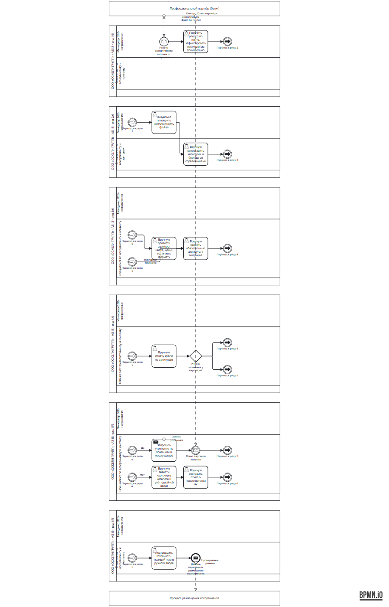
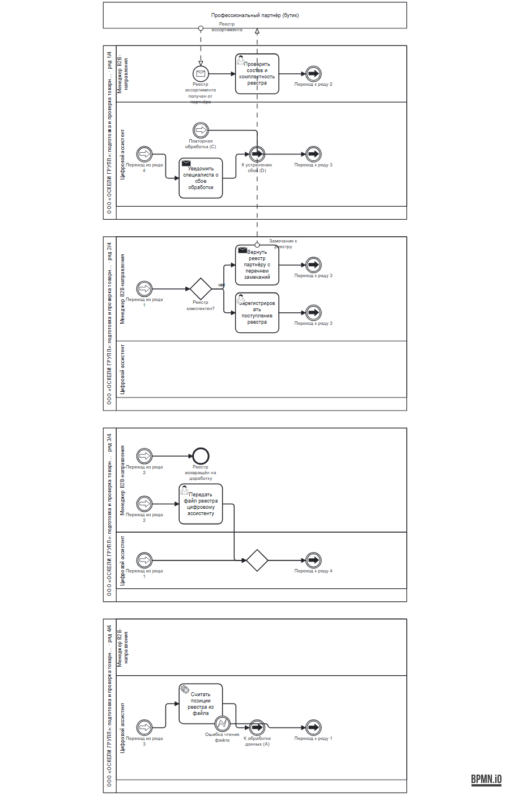
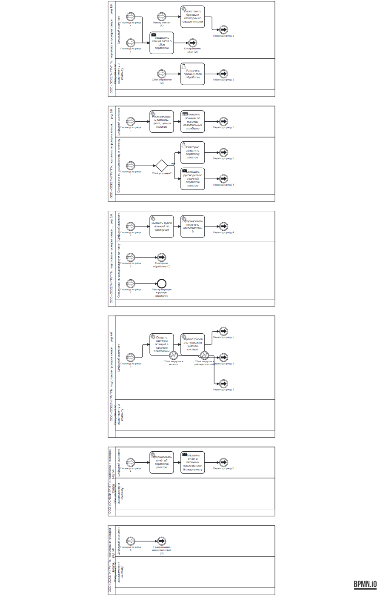
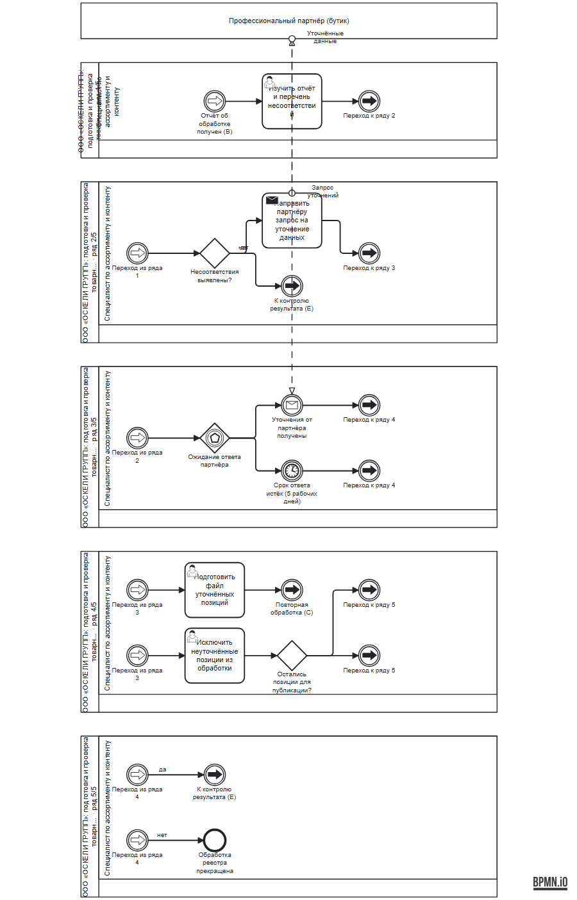
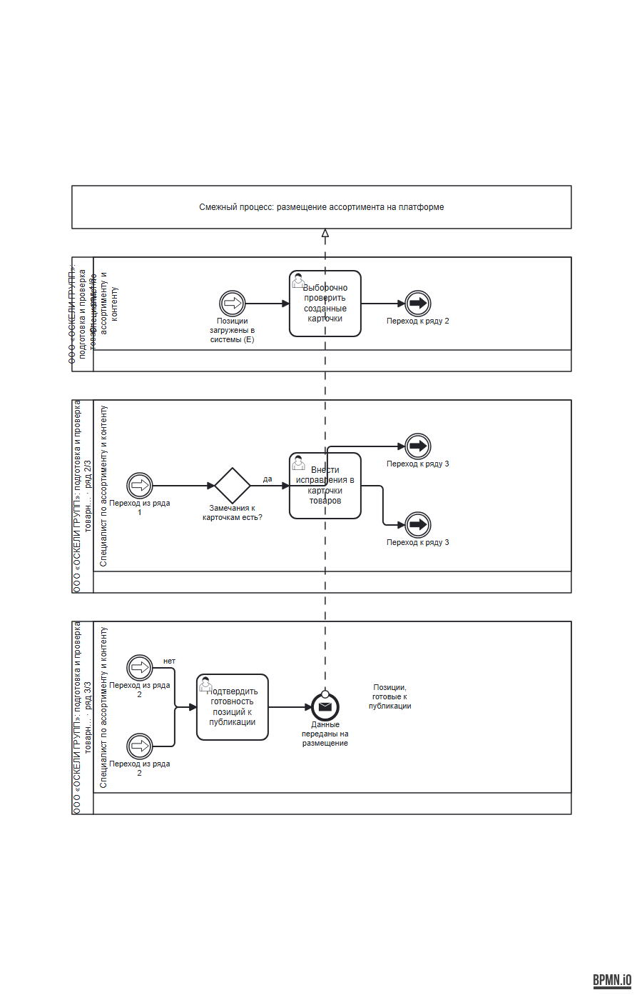

# BPMN: обработка товарных данных партнёров ООО «ОСКЕЛИ ГРУПП»

Две модели процесса «Подготовка и проверка товарных данных профессиональных партнёров»: как есть (AS IS) и целевая (TO BE). Файлы — BPMN 2.0 XML; проверены отрисовкой в bpmn-js (открываются в [bpmn.io](https://demo.bpmn.io)). Импорт в StormBPMN не проверялся.

| Файл | Что это |
|---|---|
| [`as-is.bpmn`](as-is.bpmn) | Текущий процесс: всё вручную, данные вносятся в два места |
| [`to-be-1.bpmn`](to-be-1.bpmn) | TO BE, часть 1: приём реестра, проверка комплектности, передача цифровому ассистенту |
| [`to-be-2.bpmn`](to-be-2.bpmn) | TO BE, часть 2: считывание, нормализация атрибутов, проверка качества, обработка сбоев |
| [`to-be-3.bpmn`](to-be-3.bpmn) | TO BE, часть 3: уточнение у партнёра, повторная обработка, ручная обработка |
| [`to-be-4.bpmn`](to-be-4.bpmn) | TO BE, часть 4: создание карточек, отчёт, контроль готовности, передача в размещение |

## AS IS

Исполнители и работы — по таблице 7.1 курсовой работы («Текущее выполнение»): менеджер B2B-направления принимает и проверяет комплектность реестра, специалист по ассортименту и контенту вручную сопоставляет справочники, приводит значения, ищет дубли, пишет запросы партнёру, двойным вводом заводит карточки в каталог и учётную систему и подтверждает готовность.

## TO BE

Целевая модель разбита на четыре части по подпроцессам курсовой. Цифровой ассистент (робот) выполняет рутинную цепочку работ с данными реестра; специалист остаётся для контроля и уточнений.

| Часть 1 | Часть 2 |
|---|---|
|  |  |

| Часть 3 | Часть 4 |
|---|---|
|  |  |

## Как устроены схемы

- **Ряды.** Каждая схема разложена в два столбца и несколько рядов, ширина около 570 px (было 985–1135 px). Каждый ряд — отдельный пул с теми же дорожками, подпись «· ряд N/M».
- **Переходы между рядами.** Поток, который переходит в другой ряд, заканчивается событием «Переход к ряду N» и продолжается событием «Переход из ряда M» (link-события BPMN). Так же связаны части в исходных файлах курсовой.
- **Сообщения.** Пунктир между пулами — обмен с партнёром и с процессом размещения ассортимента.
- **Высота.** Ширина уменьшена за счёт высоты: в каждом ряду дорожки повторяются. Для печати лучше использовать PNG.

Исходные файлы курсовой (`ПР7_BPMN`) не изменены. Схемы сгенерированы из их описания скриптом раскладки, проверено отрисовкой в bpmn-js.
